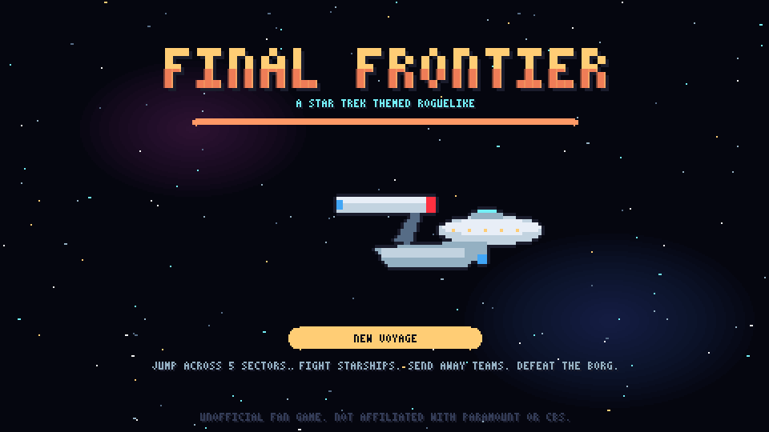
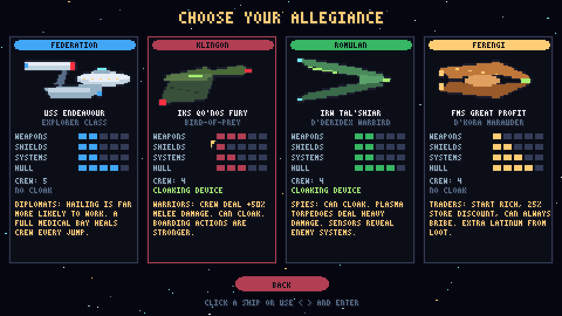
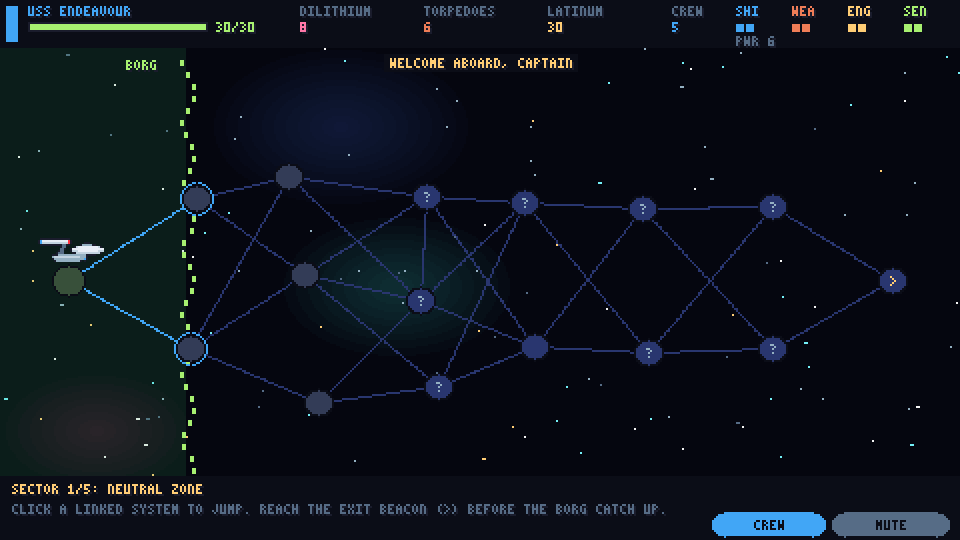
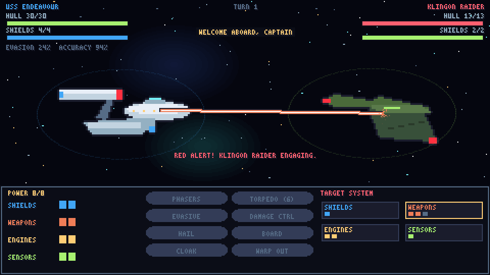
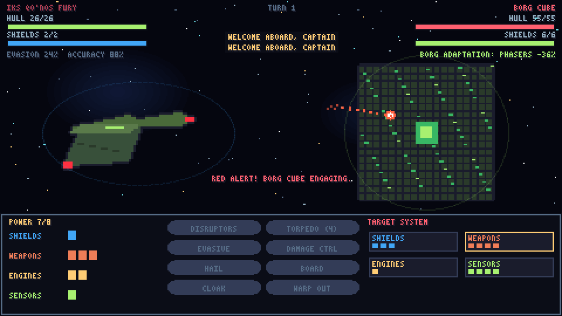
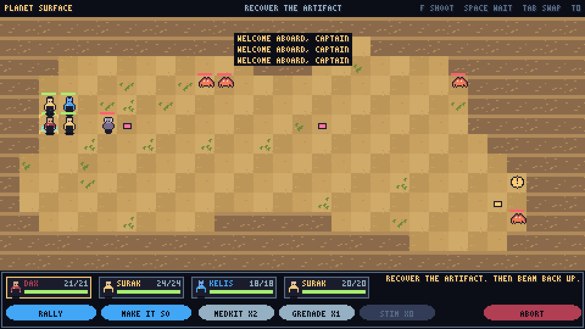
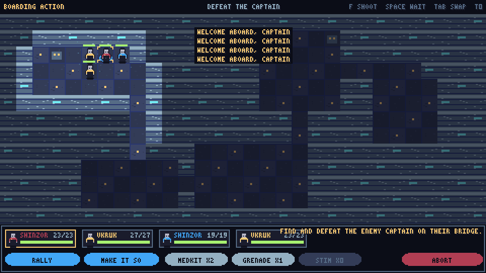
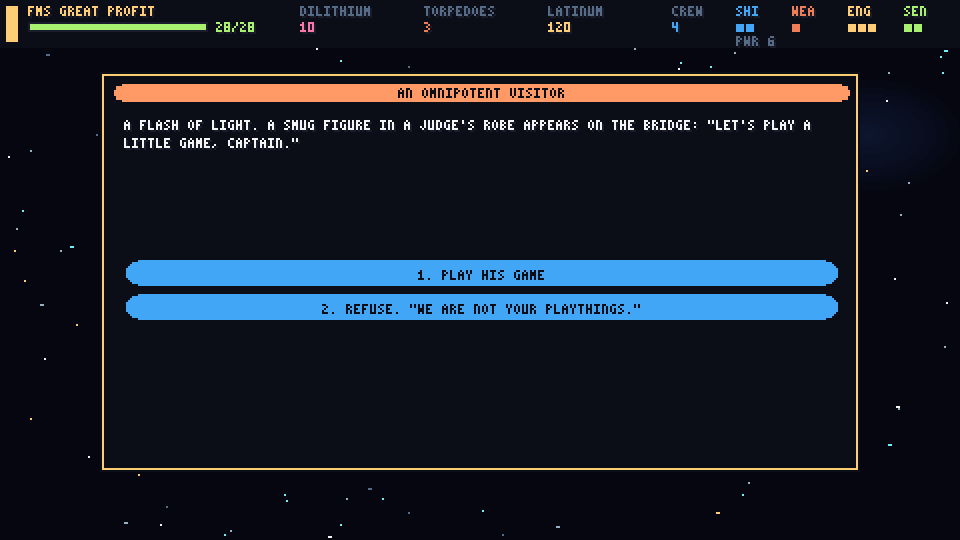
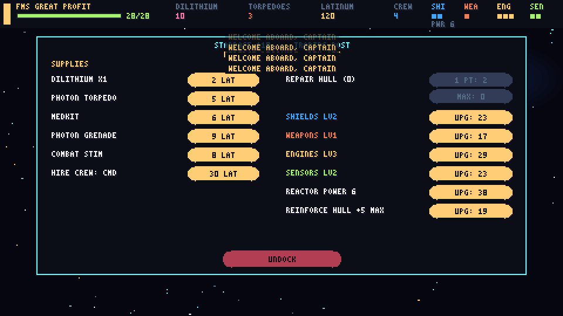

# FINAL FRONTIER

**A Star Trek themed roguelike.** You command a starship across five sectors of hostile space, choosing your jumps like in *FTL*, and send away teams down to planets in turn-based tactical missions inspired by *Rogue Fable*. Reach the end and defeat the Borg.

> **Unofficial fan game.** Not affiliated with, endorsed by, or connected to Paramount or CBS. Star Trek and related names are trademarks of their respective owners.

It is a single HTML file with no dependencies or asset files. All the art is pixel art drawn in code, and all the sound and music is synthesised live with the Web Audio API.



## Play

```sh
git clone https://github.com/des1-gner/final-frontier.git
cd final-frontier
open index.html        # macOS. On Linux use xdg-open, on Windows use start
```

No build step and no server needed. Audio starts after your first click or key press, because browsers block autoplay.

## Choose your allegiance



| Faction | Ship | Playstyle |
|---|---|---|
| **United Federation** | USS Endeavour, explorer class | Balanced, with the biggest crew. Hailing to talk your way out of a fight works far more often. Medical crew heal faster between jumps. |
| **Klingon Empire** | IKS Qo'noS Fury, Bird-of-Prey | Heavy weapons and a cloaking device. Crew deal +50% melee damage, so boarding is strong. |
| **Romulan Star Empire** | IRW Tal'Shiar, D'deridex Warbird | Cloaking device, strong sensors, and plasma torpedoes that hit harder. |
| **Ferengi Alliance** | FMS Great Profit, D'Kora Marauder | Starts rich, 25% off at every store, can always bribe enemies, and earns extra latinum from loot. |

## How a voyage works

### The sector map (FTL-style)



- You cross **5 sectors**: the Neutral Zone, the Badlands, the Briar Patch, the Gamma Quadrant Rift, and Borg Space.
- Each sector is a map of linked star systems. **Each jump costs 1 dilithium (fuel).** Jumping with none damages your hull.
- **The Borg are coming.** Each jump moves the Borg front forward. Any system it reaches is overrun, and arriving there means fighting a Borg Sphere.
- Things you'll find:
  - Hostile ships.
  - Unknown signals that trigger events.
  - Planets to send away teams to.
  - Starbases where you can shop.
  - Nebulae.
  - The exit beacon to the next sector.
- In the final sector the exit is guarded by a **Borg Cube**.

### Ship combat (turn-based)



- **Power:** spread your reactor power across **Shields, Weapons, Engines and Sensors**. More shield power raises how many shield points you can hold. Shields absorb incoming fire and recharge a little each turn.
- **Targeting:** pick which enemy system to hit. A hit that gets through their shields can knock that system out.
- **Actions:**
  - **Phasers/Disruptors:** damage depends on your weapons power.
  - **Torpedoes:** most of the damage gets past shields.
  - **Evasive manoeuvres.**
  - **Damage control:** repairs a damaged system and some hull.
  - **Hail:** try to end the fight peacefully. Ferengi can **Bribe** instead.
  - **Cloak:** Klingons and Romulans only.
  - **Warp out:** try to escape.
- **Boarding:** once the enemy's shields are down you can beam a team onto their ship. Defeat the captain on their bridge and you capture the ship for big loot. Some enemies will board *you* as well.
- **Crew stations:** helm, tactical, engineering, science and sickbay. Each gives a bonus, which is bigger when the crew member's role matches the station.
- **The Borg adapt** to your phasers the more you hit them. Torpedo hits break that adaptation.



### Away missions (Rogue Fable-style)



- Choose up to **4 crew** and beam down. Maps are generated each time, with fog of war and line of sight.
- Planet types:
  - Class M (lush).
  - Desert.
  - Ice.
  - Volcanic (lava burns you).
  - Caves.
  - Derelict stations.
- **Objectives:** recover an artifact, rescue colonists, mine dilithium, or download a data core. Then beam back up.
- **Turn-based:** you control one crew member while the rest act on their own. They follow you, shoot, heal and use their abilities.
- **Crew roles**, each with 2 abilities:

| Role | Abilities |
|---|---|
| Command | **Rally** (heal the team and boost its damage), **Make It So** (every other crew member acts immediately) |
| Security | **Phaser Burst**, **Stun** |
| Science | **Tricorder** (reveal the whole map), **Analyze** (target takes +50% damage) |
| Engineering | **Turret**, **Overload** (3×3 blast) |
| Medical | **Hypospray** (heal or revive), **Triage** |

- **Species** give small bonuses: Human, Vulcan, Andorian, Betazoid, Trill, Bolian, Bajoran, Klingon, Romulan, Reman and Ferengi.
- **Downed crew bleed out** over a few turns. Get a medic, hypospray or medkit to them in time. **Death is permanent.** Crew who survive gain XP and level up.
- **Enemies on the ground:**
  - Jem'Hadar, who can turn invisible.
  - Borg drones, which adapt to ranged fire, so use melee.
  - Klingon warriors, Romulan and Cardassian soldiers, Gorn, Orion pirates, alien beasts, security sentries.
  - Tribbles, which multiply and are harmless.
- **Items:** medkits, photon grenades, combat stims.



### Events and starbases



- **17 story events** with choices. Some choices only appear if you have the right crew role, such as **[SCI]**, **[MED]**, **[SEC]** or **[ENG]**, or are the right faction.
  - Distress calls, Orion ambushes, spatial anomalies, a smug omnipotent visitor, derelict ships, plague colonies, ion storms, holodeck malfunctions, rival captains, a stranded ambassador.
  - A tribble trader. Tribbles keep multiplying and will eventually eat your dilithium.
- **Starbases** sell dilithium, torpedoes, medkits, grenades and stims. They also offer hull repairs, system upgrades (up to level 5), reactor upgrades, stronger hulls, and new crew.



## Controls

| Where | Controls |
|---|---|
| Menus, map, events, store | Mouse. Number keys pick event options. |
| Ship combat | Mouse. `1`–`8` for actions. Click an enemy system to target it. |
| Away missions | `WASD` / arrow keys / numpad / click to move (walking into an enemy attacks it). `Q` `E` `Z` `C` move diagonally. `F` or click an enemy to shoot. `Space` to wait. `Tab` to switch crew. `1` `2` for abilities, `3`–`5` for items. `B` to beam up. |
| Anywhere | `M` to mute. On the sector map, `C` opens the crew roster, where you can reassign stations. |

## Building from source

The game is written as six files in `src/` and joined into `index.html` by a small shell script:

```sh
./build.sh
```

| File | Contents |
|---|---|
| `a_core.js` | Canvas, bitmap font, pixel helpers, particles, starfield, synthesised audio and music, input, buttons |
| `b_data.js` | Ship artwork, factions, crew roles and species, ground enemies, enemy ships |
| `c_map.js` | Run state, sector generation, jumps, events, store |
| `d_combat.js` | Turn-based ship combat |
| `e_away.js` | Away missions: map generation, line of sight, crew and enemy behaviour, abilities |
| `f_screens.js` | Title, faction select, map, planet, event, store and end screens, main loop |

## Credits

Gameplay inspired by *FTL: Faster Than Light* (Subset Games) and *Rogue Fable*. Themed after *Star Trek*. This is an unofficial, non-commercial fan project.
